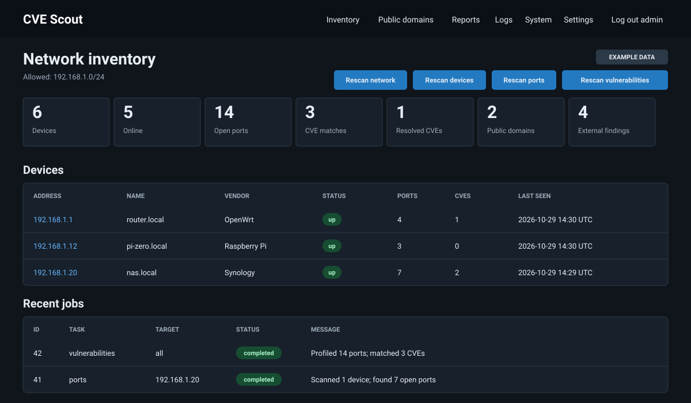

# CVE Scout

[](https://github.com/Dylpickle-Studios/cvescout/actions/workflows/ci.yml)
[](https://github.com/Dylpickle-Studios/cvescout/actions/workflows/codeql.yml)
[](https://www.python.org/)
[](LICENSE)

CVE Scout is a small, self-hosted network and public-exposure security scanner. It discovers local devices with Nmap, profiles open ports, correlates CPEs with CVEs, and checks configured public hostnames through the DNS/CDN/TLS/HTTP edge seen by internet clients.

Designed for a Raspberry Pi Zero: server-rendered HTML, SQLite, one background worker, no JavaScript framework.

> Scan only networks, devices, and public hostnames you own or have explicit permission to assess.



## Features

- Local IPv4 discovery (`nmap -sn`)
- TCP port and lightweight service/version profiling (`nmap -sV --version-light`)
- CVE correlation through NVD API, cached in SQLite
- Network, device, port, and vulnerability rescan controls
- Device inventory and current vulnerability report
- Explicit per-CVE verification: never automatic
- Small allowlist of non-destructive Nmap NSE verification scripts
- Public hostname DNS, TLS, HTTP redirect, security-header, cookie, SPF, DMARC, and CDN/WAF-edge checks
- Cloudflare, CloudFront, Fastly, Akamai, Azure Front Door, Vercel, and Netlify detection
- Public-IP-only SSRF protection; exact hostname, ports 80/443, and no redirect following
- Explicit known-origin reachability check for up to four supplied IPs, compared against the last edge scan and never stored
- Optional read-only Cloudflare API check for proxy, TLS, HTTPS, DNSSEC, and managed WAF settings
- Report export as CSV or JSON for tickets and audits
- Notifications on job failure, new high/medium findings, new high CVEs, and confirmed vulnerabilities via webhook, ntfy, gotify, or an email JSON API
- Scheduled scans through `flask --app cvescout scan` and a bundled systemd timer
- Password authentication with failed-login throttling, CSRF protection, security response headers, expiring sessions, constrained scan networks, audit log

## Install

One command on Raspberry Pi OS or another systemd Linux. It downloads the latest release, creates a service account, installs into `/opt/cvescout`, writes `/etc/cvescout.env`, installs the systemd units, and asks for an administrator password.

```sh
curl -fsSLO https://github.com/Dylpickle-Studios/cvescout/releases/latest/download/install.sh
less install.sh                      # never pipe a remote script into a shell
sudo bash install.sh --network 192.168.1.0/24
```

Then open `http://127.0.0.1:5000`, or put an HTTPS proxy in front first — see the [operations guide](docs/OPERATIONS.md).

Useful installer options:

```sh
sudo bash install.sh --with-timer      # enable the nightly port scan
sudo bash install.sh --version v0.2.0  # pin a release
sudo bash install.sh --source .        # install from a local checkout
sudo bash install.sh --no-admin        # skip the password prompt
```

Remove it again:

```sh
sudo bash install.sh --uninstall              # backs up data, then removes the install
sudo bash install.sh --uninstall --keep-data  # remove code, keep database and secret
sudo bash install.sh --uninstall --purge      # delete everything, no backup
```

`--uninstall` writes a database and secret backup to `/var/backups/cvescout-<timestamp>` unless you pass `--purge`, so an accidental uninstall does not lose your scan history.

### Manual install

```sh
sudo apt install -y python3-venv nmap
git clone https://github.com/Dylpickle-Studios/cvescout.git
cd cvescout
python3 -m venv .venv
. .venv/bin/activate
pip install .
flask --app cvescout init-admin
CVESCOUT_NETWORKS=192.168.1.0/24 gunicorn --workers 1 --threads 2 --bind 127.0.0.1:5000 'cvescout:create_app()'
```

### Hardware profiles

The installer reads the CPU count and RAM, detects the Pi model, and picks a profile. Override with `CVESCOUT_PROFILE=minimal|balanced|fast`.

| Profile | Typical hardware | Scan workers | Nmap timing | Default ports |
|---|---|---|---|---|
| `minimal` | Pi Zero / Pi Zero 2 W, 1 GB or less | 1 | `-T3` | 1-1024, 8080, 8443 |
| `balanced` | Pi 4 with 2 GB, small VPS | 2 | `-T4` | 1-1024, 8080, 8443 |
| `fast` | Pi 5 / x86 with 4 GB or more | 4 | `-T4` | 1-8192, 8443 |

A Pi Zero stays at one worker on purpose: each Nmap process costs 10-20 MB of RAM and the network, not the CPU, is the limit on a home LAN. Workers and timing can be forced with `CVESCOUT_WORKERS` and `CVESCOUT_NMAP_TIMING`.

## Requirements

- Raspberry Pi OS or another systemd Linux distribution
- Python 3.11+
- Nmap 7.x, including NSE scripts (the installer adds it)
- Internet access for fresh NVD lookups; cached results remain usable offline

## Configuration

| Variable | Default | Meaning |
|---|---|---|
| `CVESCOUT_NETWORKS` | detected default-interface network | Comma-separated authorized IPv4 CIDRs |
| `CVESCOUT_PROFILE` | `auto` | `minimal`, `balanced`, or `fast`; sets workers, Nmap timing, and ports |
| `CVESCOUT_WORKERS` | profile | Concurrent scan jobs (keep at 1 on a Pi Zero) |
| `CVESCOUT_NMAP_TIMING` | profile | Nmap `-T` timing template |
| `CVESCOUT_MAX_HOSTS` | `1024` | Maximum addresses allowed per configured CIDR |
| `CVESCOUT_PORTS` | profile | Nmap port expression |
| `CVESCOUT_NMAP` | `nmap` | Nmap executable path |
| `CVESCOUT_NVD_API_KEY` | empty | Optional NVD key; removes slow unauthenticated pacing |
| `CVESCOUT_NVD_CACHE_HOURS` | `24` | CVE lookup cache lifetime |
| `CVESCOUT_CVE_SOURCES` | `nvd,circl` | CVE sources to query (`nvd`, `circl`) |
| `CVESCOUT_INTEL_HOURS` | `24` | How long KEV/EPSS data stays fresh |
| `CVESCOUT_SCAN_TIMEOUT` | `900` | Maximum Nmap scan seconds |
| `CVESCOUT_CHECK_TIMEOUT` | `120` | Maximum verification seconds |
| `CVESCOUT_DOMAIN_TIMEOUT` | `8` | DNS/socket timeout for public hostname checks |
| `CVESCOUT_DOMAIN_MAX_BYTES` | `65536` | Maximum response bytes read from a public hostname |
| `CVESCOUT_CLOUDFLARE_API_TOKEN` | empty | Optional scoped read-only Cloudflare token; kept only in process environment |
| `CVESCOUT_HISTORY_DAYS` | `90` | Delete finished jobs/checks/events older than this; `0` keeps all |
| `CVESCOUT_NOTIFY_TIMEOUT` | `10` | Seconds allowed per notification delivery |
| `CVESCOUT_SESSION_HOURS` | `12` | Browser session lifetime |
| `CVESCOUT_SECRET_FILE` | `instance/secret_key` | Persistent Flask session secret path |
| `CVESCOUT_HTTPS` | `0` | Set `1` when browser reaches app through HTTPS |

Network detection can be too broad on unusual routing setups. Set `CVESCOUT_NETWORKS` explicitly. Scans and checks reject targets outside configured CIDRs.

## Scan flow

1. **Rescan network** discovers devices.
2. **Rescan devices** refreshes status and host metadata.
3. **Rescan ports** profiles open ports and CPEs.
4. **Rescan vulnerabilities** queries NVD for each CPE and caches matches.
5. **Check** runs only after user clicks it for one CVE.
6. **Public domains** lets an authenticated user add an authorized hostname and queue an edge scan.
7. **Check origin exposure** accepts up to four known public origin IPs for one explicit, non-persistent reachability test.
8. **Check Cloudflare** reads zone configuration when a scoped API token is configured.

Public domain scans validate that every resolved address is globally routable, then connect directly to one of those validated addresses with the configured hostname as TLS SNI and HTTP `Host`. This prevents localhost/private-network SSRF and DNS rebinding between validation and connection.

### CVE sources and exploit intelligence

CVE Scout does not contain a vulnerability database. It asks public CVE sources about the CPE (product and version) that Nmap reported for each open port, then stores the matching CVEs locally with severity and CVSS score.

Two sources are queried by default:

| Source | How it matches | Why |
|---|---|---|
| **NVD** ([nvd.nist.gov](https://nvd.nist.gov/)) | exact `cpeName`, version-aware | authoritative severities |
| **CIRCL Vulnerability-Lookup** ([vulnerability.circl.lu](https://vulnerability.circl.lu/)) | CPE vendor + product, then a local version-range check | NVD only enriches CVEs it selects, so this recovers CVEs NVD never annotated |

Set `CVESCOUT_CVE_SOURCES=nvd` to use NVD alone, or `circl` for the aggregate only.

Each finding carries a match confidence:

- **version** — the discovered version falls inside a range the CVE declares, or NVD returned it for that exact CPE
- **product** — the CVE affects this product but no usable version range exists, so it is stored as a lead and never raises an alert

Every finding is also ranked with two public exploit signals:

- **KEV** — the CVE is in CISA's Known Exploited Vulnerabilities catalogue
- **EPSS** — FIRST's probability of exploitation in the next 30 days

The report sorts exploited-first, then by EPSS, then by CVSS. Refresh them on demand with `flask --app cvescout refresh-intel`; they are also refreshed during a vulnerability scan, at most once per `CVESCOUT_INTEL_HOURS`.

Only the CPE string leaves your network. NVD never scans, probes, or connects to your devices, and NVD lookups fail safe: cached results keep working offline.

| | NVD allows | CVE Scout paces at |
|---|---|---|
| No API key (default) | 5 requests per 30 s | 6.1 s between requests |
| With API key | 50 requests per 30 s | 0.7 s between requests |

One request is made per **unique CPE**, not per port, and results are cached for `CVESCOUT_NVD_CACHE_HOURS` (default 24 hours), so later scans are fast.

A key is optional. It only speeds up the first vulnerability scan:

- ~25 unique CPEs: about 2-3 minutes without a key
- ~150 unique CPEs: about 15 minutes without a key, about 2 minutes with one

Request a free key at <https://nvd.nist.gov/developers/request-an-api-key> and add it to `/etc/cvescout.env`:

```ini
CVESCOUT_NVD_API_KEY=your-key-here
```

Restart CVE Scout afterwards (`sudo systemctl restart cvescout`). If a scan reports HTTP 403 or 429, the rate limit was hit; wait a minute or add a key.

Findings have a lifecycle. A finding that disappears from a later scan is marked resolved rather than deleted, so the current report stays clean while history survives. If it comes back, `resolved_at` clears and it alerts again. Device pages mark findings first seen in the most recent scan with a **New** badge, and the dashboard counts resolved CVEs separately.

CVE matches are version-based leads, not proof. Current explicit verification allowlist:

- CVE-2014-0160 — `ssl-heartbleed`
- CVE-2014-0224 — `ssl-ccs-injection`
- CVE-2014-3566 — `ssl-poodle`
- CVE-2015-4000 — `ssl-dh-params`

Other CVEs show “No safe checker available.” Add checks only when they are bounded and non-destructive.

### Public domain scan boundary

Public scans inspect only the exact configured hostname. They query public DNS records and make bounded `GET /` requests on ports 80 and 443. Redirects are recorded but not followed. They do not enumerate subdomains, discover historical DNS, guess origin IPs, submit credentials, or send exploit payloads.

Known-origin checks run only after a user supplies one to four globally routable IPs and confirms authorization. The addresses remain in worker memory only; they are not written to jobs, checks, reports, or audit events. A `reachable` result means at least one supplied origin answered directly with the public hostname, and the summary says how many of how many. Results are compared against the last domain scan and state its age, so rescan after changing the edge. A `not_reachable` result is a point-in-time observation covering only the supplied addresses.

### Cloudflare read-only check

Set a scoped API token before starting CVE Scout:

```sh
export CVESCOUT_CLOUDFLARE_API_TOKEN='...'
```

Grant only read permissions needed for zone metadata, DNS records, zone settings, DNSSEC, and optionally managed WAF/rulesets. The token is sent only to `api.cloudflare.com`, is never stored in SQLite, and is never shown in reports or logs. See Cloudflare API documentation for [zone settings](https://developers.cloudflare.com/api/resources/zones/subresources/settings/), [DNS records](https://developers.cloudflare.com/api/resources/dns/subresources/records/), and [DNSSEC](https://developers.cloudflare.com/api/resources/dns/subresources/dnssec/).

## Notifications

Configure channels under **Settings**. Everything is stored in the local database and edited in the browser; there is no extra config file.

| Channel | What it sends |
|---|---|
| Webhook | `POST` JSON `{source, title, message, priority}` to your URL |
| ntfy | `POST` the message body to a topic URL, with `Title` and `Priority` headers; optional bearer token |
| gotify | `POST` `{title, message, priority}` to `<server>/message?token=...` |
| Email API | `POST` JSON `{from, to, subject, text}` to a provider endpoint with an optional bearer token; Resend-style APIs work unchanged |

Notifications fire on: job failure, a new high or medium public hostname finding, a new high or critical CVE match, and a CVE verification that comes back vulnerable. Repeated results do not repeat, because new findings are compared with what was already stored.

Delivery is best effort: one short timeout, no retries, and a failure only adds an audit event, so a broken webhook never blocks a scan. Tokens are stored in SQLite and never rendered back to the browser.

## Web UI

| Page | What it shows |
|---|---|
| Inventory | device table, running jobs, recent audit events |
| Device | open ports, matched CVEs with match confidence, KEV/EPSS, explicit **Check** |
| Public domains | hostname inventory plus edge scans, origin and Cloudflare checks |
| Reports | paginated findings, CSV/JSON/SARIF download, provider and CVE verification history |
| Logs | paginated audit log with a level filter |
| System | version, schema version, hardware profile, DB size, row counts, sources, last job per kind |
| Settings | notification channels and test delivery |

Pages that show job state refresh themselves every 5 seconds while work is running, and keep their scroll position. Reports, the audit log, and device pages show 50 rows at a time; every export always contains everything. The stylesheet has a print mode for reports.

### Exports

| URL | Format | Scope |
|---|---|---|
| `/reports.csv` | CSV | every finding, both CVEs and public hostname findings |
| `/reports.json` | JSON | same rows plus a device block for per-device exports |
| `/reports.sarif` | SARIF 2.1.0 | same rows, for code scanning, SIEMs, and DefectDojo-style importers |
| `/devices/<id>.csv` | CSV | one device |
| `/devices/<id>.json` | JSON | one device, with its address, hostname, and status |

Every row carries severity, CVSS score, match confidence, source, KEV flag, EPSS score, last check result, `first_seen`, and last-seen time, so a report can be handed to a person or a language model without extra lookups. Because `first_seen` is recorded once and kept, two exports can be diffed to show what is new. SARIF results use stable fingerprints, so re-importing an unchanged network does not reopen closed findings.

## Raspberry Pi Zero notes

A Pi Zero W is a single-core ARMv6 board with 512 MB of RAM and a 32-bit OS. The `minimal` profile is built for exactly that: one worker, `-T3`, and a reduced port range.

- 350 MB free RAM runs Gunicorn (one worker, two threads) plus one Nmap process comfortably. It does not run two.
- The OS must provide Python 3.11 or newer, which means Raspberry Pi OS Bookworm or later. Bullseye ships 3.9 and will refuse to install.
- A full 1024-port scan of a /24 takes roughly 30-90 minutes on a single-core Zero. Start with a short port list, then widen:

```ini
CVESCOUT_PORTS=22,23,53,80,443,445,548,554,631,1883,3306,3389,5000,5432,6379,8080,8443,9100
```

- Keep Gunicorn at one worker; the job queue lives in process memory.
- NVD without an API key enforces conservative pacing, so the first vulnerability scan is the slow one.
- Use a DHCP reservation for the Pi's address, since SSH and any proxy bookmark will otherwise break when the lease changes.
- SQLite uses WAL mode. Back up `instance/cvescout.sqlite3` plus `instance/secret_key`, and keep `CVESCOUT_HISTORY_DAYS` at 90 or lower to limit SD card writes.

## Development

Routes live under `cvescout/views/`, one module per area. They share a single `main`
blueprint, so `url_for('main.device', ...)` keeps working wherever a route is moved.

```sh
pip install -e '.[dev]'
ruff check .
python -m unittest discover -s tests -v
python -m build
```

Architecture: [docs/ARCHITECTURE.md](docs/ARCHITECTURE.md)  
Operations, scheduled scans, and systemd: [docs/OPERATIONS.md](docs/OPERATIONS.md)  
Security policy: [SECURITY.md](SECURITY.md)  
Release history: [CHANGELOG.md](CHANGELOG.md)

## License

MIT. See [LICENSE](LICENSE).
